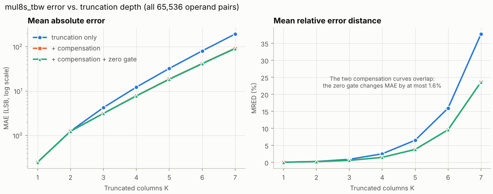
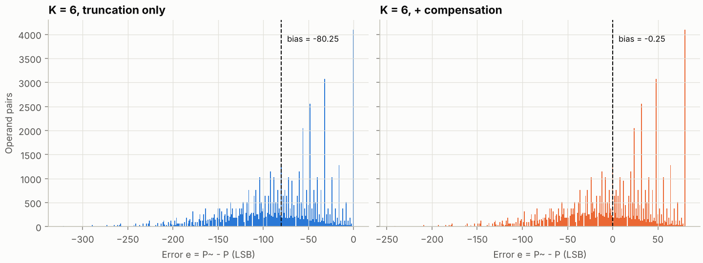

# Approximate Multiplier: Truncated Baugh-Wooley (`mul8s_tbw`)

## 1. Choice of technique

Several approximation families were considered (see the project blueprint):
column truncation, broken-array multipliers, approximate 4:2 compressors,
logarithmic (Mitchell/DRUM) multipliers, and recursive 2x2 blocks.
Column truncation of the Baugh-Wooley matrix was selected because:

* It acts directly on the verified signed datapath of `mul8s_bw`. Signed
  correctness follows from keeping every sign-related term (section 3).
* One parameter, `TRUNC_COLS = K`, sweeps a family of designs with `K = 0`
  identical to the exact multiplier. Verification therefore covers exact
  and approximate behaviour with one code path.
* The error has a closed form, so the bias and its compensation can be
  derived rather than tuned.
* Approximate compressors target ASIC transistor count. Their benefit on
  LUT6-based FPGAs is not established, so they are left as a possible
  extension.

Truncated multiplication with a correction constant is established in the
literature (e.g. Schulte and Swartzlander, 1993). No novelty is claimed. The
contribution of this repository is a verified, parameterized signed INT8
implementation together with its measured characterisation.

## 2. Arithmetic definition

With `K = TRUNC_COLS`:

```
P~(A, B) = A*B - L_K(A, B) + C_K          (then forced to 0 if ZERO_GATE and A*B has a zero operand)

L_K(A, B) = sum_{i+j<K} a_i b_j 2^(i+j)  (value of the removed partial-product bits)
C_K       = COMP_EN ? round(((K-1) 2^K + 1) / 4) : 0
```

| Parameter | Range | Meaning |
|---|---|---|
| `TRUNC_COLS` | 0..7 (default 4) | Number of least-significant matrix columns removed |
| `COMP_EN` | 0/1 (default 1) | Add the bias-compensation constant `C_K` |
| `ZERO_GATE` | 0/1 (default 1) | Force `p = 0` when `a == 0` or `b == 0` |

The defaults are a mid-range operating point that preserves `0 * x = 0`. The
recommended configuration will be chosen after the FPGA measurements (v0.3.0).

## 3. Why K is limited to 7

For `K <= 7` every removed bit satisfies `i + j <= 6`, so `i, j <= 6`. Each
removed bit is therefore a plain unsigned AND term `a_i b_j`, with no sign bit,
no inverted (NAND) term and no correction constant. This is what makes
`L_K` above exact and keeps the signed correction of section 2.1 of
[architecture.md](architecture.md) intact.

Column 7 holds `~(a7 b0)` and `~(a0 b7)`, which are part of the signed
correction. Truncating it (`K = 8`) would make `0 x B` non-zero even without
compensation, so the RTL rejects `TRUNC_COLS > 7` at elaboration time.

## 4. Bias and compensation

Without compensation, `e = -L_K <= 0` for every input: plain truncation only
ever under-estimates. For uniformly distributed operands each `a_i b_j`
(`i, j <= 6`) equals 1 with probability 1/4, so

```
E[L_K] = (1/4) * sum_{s=0}^{K-1} (s+1) 2^s = ((K-1) 2^K + 1) / 4
```

| K | 1 | 2 | 3 | 4 | 5 | 6 | 7 |
|---|---|---|---|---|---|---|---|
| E[L_K] | 0.25 | 1.25 | 4.25 | 12.25 | 32.25 | 80.25 | 192.25 |
| C_K | 0 | 1 | 4 | 12 | 32 | 80 | 192 |

`C_K` is the nearest integer, so the remaining bias is always -0.25 LSB.
The closed form is checked against the exhaustive mean in
`tests/test_approx.py`. The RTL computes `C_K` with the integer expression
`(((K-1) << K) + 3) / 4`.

**Trade-off: compensation breaks `0 x B = 0`.** With `C_K != 0`, every pair
that has a zero operand returns `C_K` (all 511 such pairs). Sparse INT8
workloads (ReLU outputs, zero padding) would then accumulate a systematic
offset. `ZERO_GATE` restores exact zeros at the cost of a zero detector and an
output mask. It also shifts the mean slightly, because `C_K` was derived
including the zero pairs. For example, at `K = 6` the bias goes from -0.25 to
-0.87 LSB.

## 5. Hardware mapping

```
          a, b
            |
   bw_ppgen8 #(TRUNC_COLS = K)       pp bits with i+j < K tied to 0
            | r0 .. r7
            |        r8 = C_K (constant row)
            v
   L1: 3 x CSA   9 -> 6
   L2: 2 x CSA   6 -> 4
   L3: 1 x CSA   4 -> 3
   L4: 1 x CSA   3 -> 2
   CPA (carry chain)
            |
   optional zero gate  ((a == 0) || (b == 0)) ? 0 : sum
            |
            p
```

* Truncated bits are tied to constant 0 in `bw_ppgen8`. Synthesis removes
  their AND gates and simplifies the adder cells that only see zeros.
* `C_K` may have bits in columns that are already full (for example,
  `C_7 = 192` sets bit 7, and column 7 has height 8). It is therefore a ninth
  constant row instead of being packed into empty slots. A 9-row Wallace
  reduction still needs four 3:2 levels, so the adder depth is unchanged.
  Constant bits reduce the adder cells they touch to XNOR/OR logic.
* The 9-row tree differs from the 8-row tree of `mul8s_bw`. For hardware
  comparisons the like-for-like exact reference is `mul8s_tbw` with `K = 0`
  and `COMP_EN = 0`. Both exact structures will be reported in v0.3.0.

## 6. Measured error characteristics

All values are exhaustive over the 65,536 operand pairs and generated by
`make results` (full table:
[results/error_metrics.md](../results/error_metrics.md), CSV:
[results/error_metrics.csv](../results/error_metrics.csv)).

| K | Mode | ER | MAE | NMED | MRED | Bias |
|---|---|---|---|---|---|---|
| 2 | comp | 93.75% | 1.250 | 7.63e-05 | 0.24% | -0.250 |
| 4 | none | 81.25% | 12.250 | 7.48e-04 | 2.53% | -12.250 |
| 4 | comp | 90.62% | 7.852 | 4.79e-04 | 1.49% | -0.250 |
| 4 | compzg | 89.85% | 7.758 | 4.74e-04 | 1.49% | -0.344 |
| 6 | comp | 98.05% | 41.771 | 2.55e-03 | 9.60% | -0.250 |
| 7 | comp | 100.00% | 92.124 | 5.62e-03 | 23.64% | -0.250 |



Observations:

1. **MAE grows by 2.4-3.4x per truncated column for `K >= 3`**, as expected
   from `E[L_K]`. Compensation removes the bias and reduces MAE by 26%
   (`K = 3`) up to 52% (`K = 7`). At `K = 2` the MAE is unchanged.
2. **ER is not a useful selection metric here.** Compensation raises ER (for
   example from 50% to 93.75% at `K = 2`), because it turns many small
   negative errors into small non-zero positive ones. Over the same pairs the
   MSE falls from 3.8 to 2.2.
3. **The error depends only on the low operand bits, not on sign or
   magnitude.** `L_K` uses `a[K-1:0]` and `b[K-1:0]` only. This is visible as
   a periodic tile pattern with period `2^K`
   ([heatmap](../results/figures/error_heatmap_k6_comp.png)). MAE is nearly
   identical across the four sign quadrants
   ([results/error_by_quadrant.csv](../results/error_by_quadrant.csv)).
4. **Relative error concentrates on small products.** The absolute error is
   independent of magnitude, so the relative error falls by about 2x per
   octave of `|P|`
   ([figure](../results/figures/relative_error_vs_magnitude.png)). This is why
   MRED grows much faster than NMED. It also matters for CNN inference, where
   many products are small.



## 7. Verification

`mul8s_tbw` is verified bit-exact against `models/approx_tbw.py` for all 24
configurations (`K = 0..7` with modes none, comp and compzg) over all
65,536 pairs. Two model formulations, the closed form and the matrix form,
are cross-checked in pytest. Mutation tests cover truncation boundaries,
the compensation row, tree wiring and the zero gate. See
[verification.md](verification.md).

## References

1. M. J. Schulte and E. E. Swartzlander, "Truncated multiplication with
   correction constant," in *VLSI Signal Processing VI*, IEEE, 1993,
   pp. 388-396.
2. H. R. Mahdiani, A. Ahmadi, S. M. Fakhraie, and C. Lucas, "Bio-inspired
   imprecise computational blocks for efficient VLSI implementation of
   soft-computing applications," *IEEE Trans. Circuits Syst. I*, vol. 57,
   no. 4, pp. 850-862, Apr. 2010.
3. A. Momeni, J. Han, P. Montuschi, and F. Lombardi, "Design and analysis of
   approximate compressors for multiplication," *IEEE Trans. Computers*,
   vol. 64, no. 4, pp. 984-994, Apr. 2015.
4. S. Ullah, S. S. Murthy, and A. Kumar, "SMApproxLib: Library of FPGA-based
   approximate multipliers," in *Proc. DAC*, 2018.
